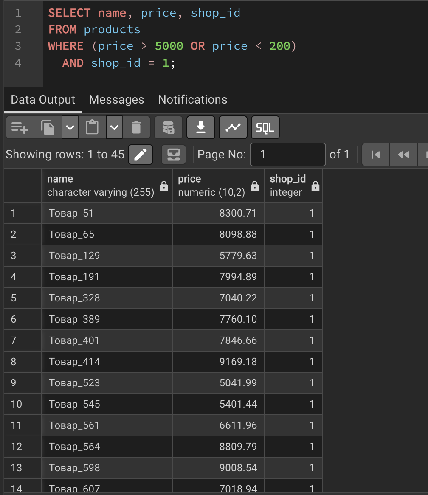
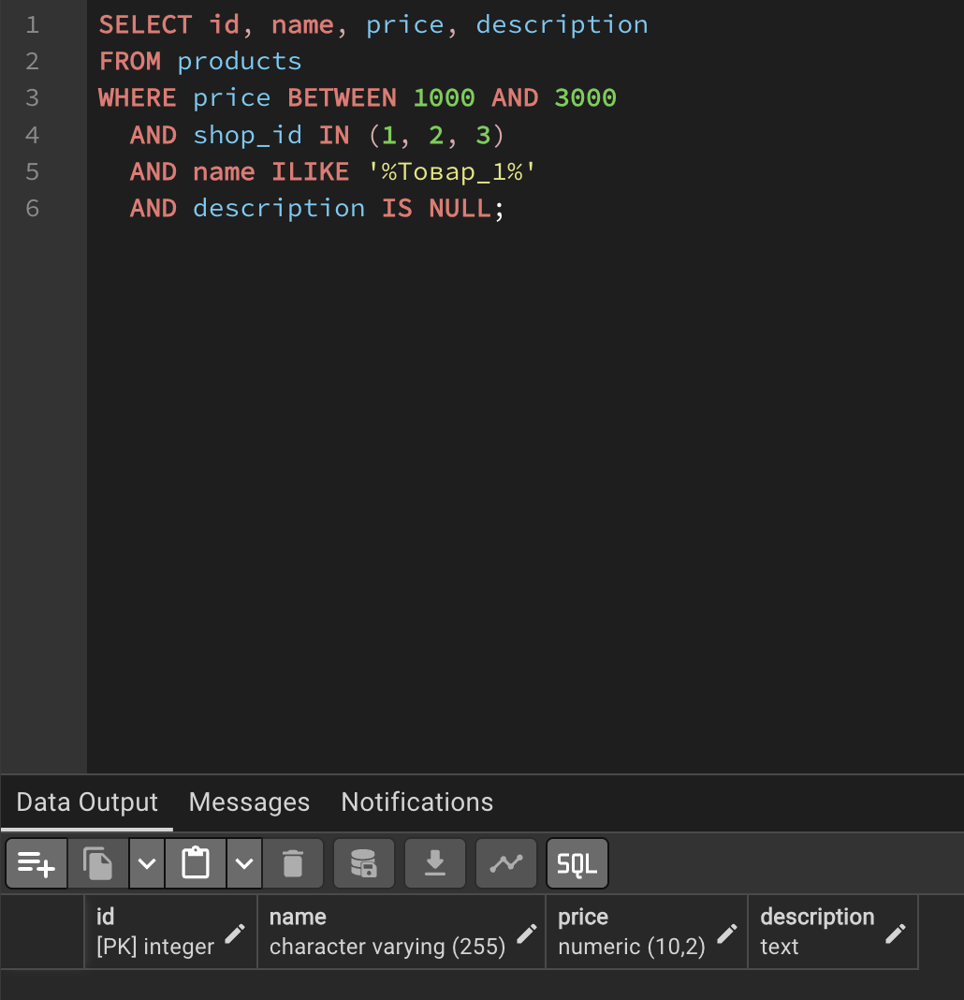
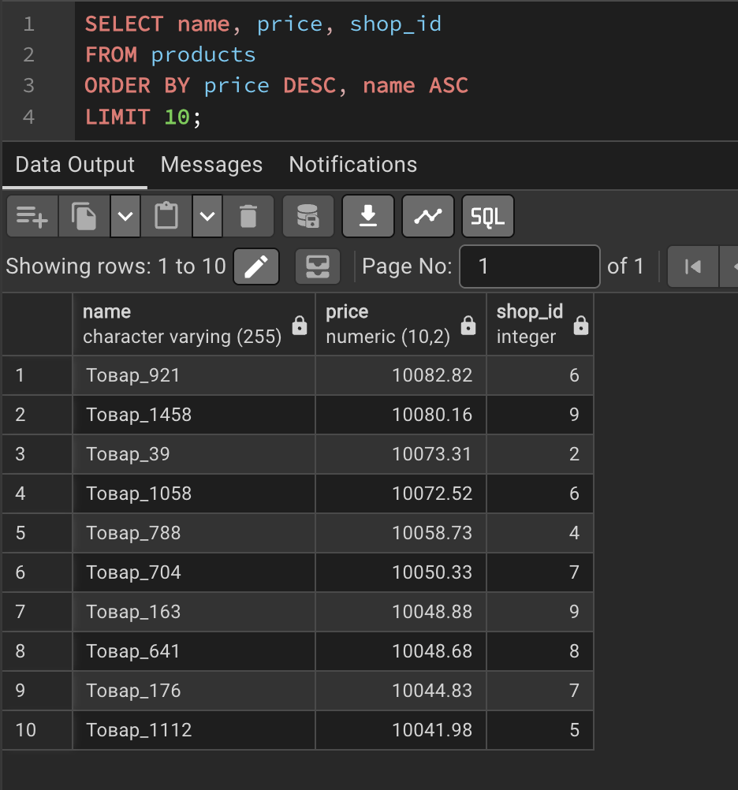
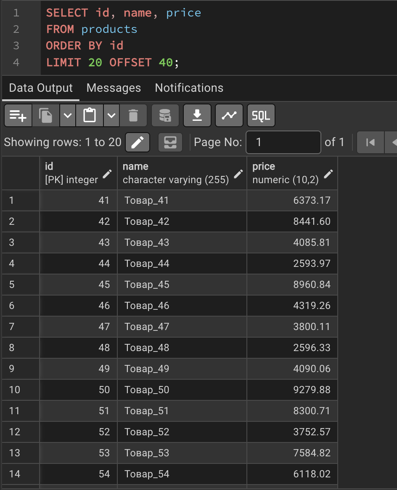
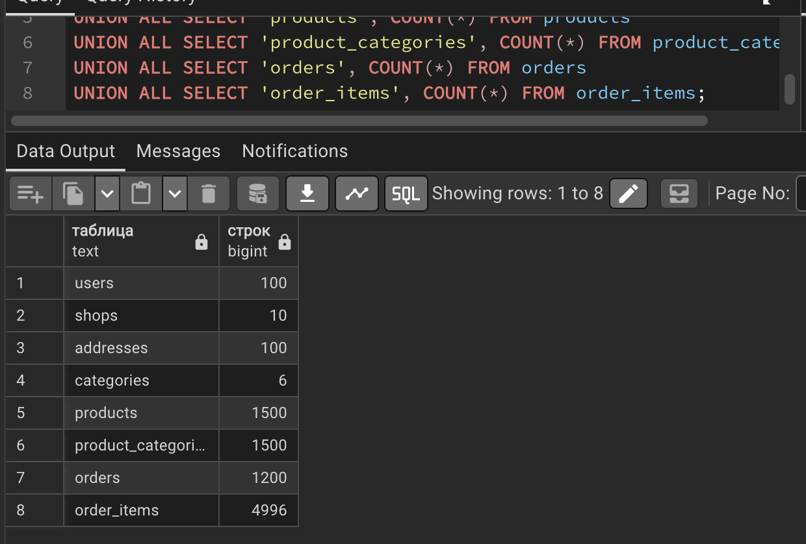

# Отчёт по лабораторной работе №2
## Тема: Базовые SQL-запросы и фильтрация данных

### Выполнила: Овчинникова Анна БВТ2502

---

## 1. Постановка задачи

Наполнить спроектированную базу данных маркетплейса тестовыми данными и составить набор запросов на выборку и фильтрацию. База и запросы должны:
- содержать не менее 1000 строк в крупных таблицах (`products`, `orders`);
- демонстрировать использование `DISTINCT` и псевдонимов столбцов;
- включать фильтрацию с комбинацией `AND`, `OR` и скобок;
- применять предикаты `BETWEEN`, `IN`, `LIKE` (или `ILIKE`) и `IS NULL`;
- реализовывать сортировку по двум столбцам в разных направлениях;
- реализовывать постраничный вывод с помощью `LIMIT` и `OFFSET`;
- сопровождаться текстом запроса, его назначением и фрагментом результата.

---

## 2. Наполнение таблиц тестовыми данными

Для генерации большого объёма согласованных данных использована функция `generate_series` в сочетании с `random()`. Для избежания ошибок дублирования составного первичного ключа в `order_items` применена конструкция `ON CONFLICT DO NOTHING`.

```sql

TRUNCATE TABLE payments, reviews, order_items, orders, 
             product_categories, products, addresses, shops, 
             categories, users RESTART IDENTITY CASCADE;


INSERT INTO users (email, password_hash)
SELECT 'user_' || g || '@marketplace.com', md5(random()::text)
FROM generate_series(1, 100) AS g;


INSERT INTO shops (owner_id, name, description)
SELECT (random() * 99 + 1)::int, 'Магазин №' || g, 'Описание магазина номер ' || g
FROM generate_series(1, 10) AS g;


INSERT INTO addresses (user_id, city, street, zip_code)
SELECT (random() * 99 + 1)::int, 'Москва', 'ул. Пушкина, д. ' || g, '101000'
FROM generate_series(1, 100) AS g;


INSERT INTO categories (name, parent_category_id) VALUES 
('Электроника', NULL), ('Одежда', NULL), ('Книги', NULL);
INSERT INTO categories (name, parent_category_id) VALUES 
('Смартфоны', 1), ('Ноутбуки', 1), ('Футболки', 2);


INSERT INTO products (shop_id, name, description, price)
SELECT 
    (random() * 9 + 1)::int, 
    'Товар_' || g, 
    'Подробное описание для товара номер ' || g,
    (random() * 10000 + 100)::numeric(10, 2)
FROM generate_series(1, 1500) AS g;


INSERT INTO product_categories (product_id, category_id)
SELECT id, (random() * 5 + 1)::int FROM products
ON CONFLICT DO NOTHING;


INSERT INTO orders (user_id, address_id, status, total_amount, created_at)
SELECT 
    (random() * 99 + 1)::int,
    (random() * 99 + 1)::int,
    (ARRAY['new', 'paid', 'shipped', 'delivered'])[floor(random() * 4 + 1)::int],
    (random() * 20000 + 500)::numeric(12, 2),
    NOW() - (random() * 365 || ' days')::interval
FROM generate_series(1, 1200) AS g;


INSERT INTO order_items (order_id, product_id, quantity, price_at_purchase)
SELECT 
    (random() * 1199 + 1)::int,
    (random() * 1499 + 1)::int,
    (random() * 3 + 1)::int,
    (random() * 10000 + 100)::numeric(10, 2)
FROM generate_series(1, 5000) AS g -- берём с запасом, часть отсечётся
ON CONFLICT (order_id, product_id) DO NOTHING;


UPDATE products SET description = NULL WHERE id % 10 = 0;
```

---

## 3. Реализация запросов и результаты

### Задание 2. Выборка с DISTINCT и псевдонимами
**Текст запроса:**
```sql
SELECT DISTINCT shop_id AS seller_id 
FROM products 
ORDER BY seller_id;
```
**Назначение:** Получить список уникальных идентификаторов магазинов, которые имеют хотя бы один товар в каталоге. Ключевое слово `DISTINCT` устраняет дубликаты, так как один магазин продаёт множество товаров.


---

### Задание 3. Фильтрация с AND, OR и скобками
**Текст запроса:**
```sql
SELECT name, price, shop_id 
FROM products 
WHERE (price > 5000 OR price < 200) 
  AND shop_id = 1;
```
**Назначение:** Найти в первом магазине либо очень дорогие товары (дороже 5000), либо очень дешёвые (дешевле 200). Скобки обязательны: без них оператор `AND` выполнился бы раньше `OR`, и логика выборки нарушилась бы.



---

### Задание 4. Применение предикатов BETWEEN, IN, LIKE, IS NULL
**Текст запроса:**
```sql
SELECT id, name, price, description 
FROM products 
WHERE price BETWEEN 1000 AND 3000       
  AND shop_id IN (1, 2, 3)                
  AND name ILIKE '%Товар_1%'             
  AND description IS NULL;               
```
**Назначение:** Сложный поиск товаров. Мы ищем товары из первых трёх магазинов, ценой от 1000 до 3000, в названии которых есть "Товар_1", и у которых **не заполнено** описание (мы специально обнулили их на шаге 10).



---

### Задание 5. Сортировка по двум столбцам
**Текст запроса:**
```sql
SELECT name, price, shop_id 
FROM products 
ORDER BY price DESC, name ASC 
LIMIT 10;
```
**Назначение:** Вывести топ-10 самых дорогих товаров. Если у нескольких товаров одинаковая цена (`DESC` — по убыванию), они будут отсортированы между собой по алфавиту (`ASC` — по возрастанию названия).



---

### Задание 6. Постраничный вывод
**Текст запроса:**
```sql
SELECT id, name, price 
FROM products 
ORDER BY id 
LIMIT 20 OFFSET 40;
```
**Назначение:** Реализация пагинации каталога. `LIMIT 20` показывает по 20 строк, а `OFFSET 40` пропускает первые 40 строк (то есть страницы 1 и 2), начиная вывод с 41-й строки.
**Результат:**



---

## 4. Проверка работоспособности (Сводная статистика)

Для подтверждения корректного наполнения базы выполнен агрегирующий запрос:

```sql
SELECT 'users' AS таблица, COUNT(*) AS строк FROM users
UNION ALL SELECT 'shops', COUNT(*) FROM shops
UNION ALL SELECT 'addresses', COUNT(*) FROM addresses
UNION ALL SELECT 'categories', COUNT(*) FROM categories
UNION ALL SELECT 'products', COUNT(*) FROM products
UNION ALL SELECT 'product_categories', COUNT(*) FROM product_categories
UNION ALL SELECT 'orders', COUNT(*) FROM orders
UNION ALL SELECT 'order_items', COUNT(*) FROM order_items;
```


---

## 5. Принятые проектные решения

- **Генерация данных:** Использована функция `generate_series` совместно с `random()`, так как это стандартный и наиболее производительный способ создания больших массивов тестовых данных в PostgreSQL без написания внешних скриптов.
- **Обработка конфликтов:** При вставке в `order_items` добавлена конструкция `ON CONFLICT (order_id, product_id) DO NOTHING`. Это предотвращает падение скрипта из-за математической вероятности генерации одинаковых пар ключей функцией `random()`.
- **Регистронезависимый поиск:** В задании 4 использован оператор `ILIKE` вместо `LIKE`, так как в реальных маркетплейсах пользователи не контролируют регистр при вводе поисковых запросов.
- **Явное указание столбцов:** Во всех запросах избегается использование `SELECT *`, что соответствует лучшим практикам: снижает нагрузку на сеть и делает запрос устойчивым к будущим изменениям схемы таблиц.

---

## 6. Ответы на контрольные вопросы

1. **Из каких секций состоит SELECT и порядок выполнения?**  
   Секции: `SELECT`, `FROM`, `WHERE`, `GROUP BY`, `HAVING`, `ORDER BY`, `LIMIT`.  
   *Логический порядок выполнения:* `FROM` → `WHERE` → `GROUP BY` → `HAVING` → `SELECT` → `ORDER BY` → `LIMIT`.
2. **Почему не рекомендуется SELECT *?**  
   Это передаёт лишние данные по сети, снижает производительность, ломает код при изменении структуры таблицы (добавлении столбцов) и делает запросы менее читаемыми.
3. **Для чего WHERE и как комбинировать условия?**  
   `WHERE` фильтрует строки до этапа группировки. Условия комбинируются через `AND` (и), `OR` (или), `NOT` (не). Приоритет `AND` выше, поэтому для изменения логики вычисления используют скобки `()`.
4. **BETWEEN и IN vs операторы сравнения и OR?**  
   `BETWEEN a AND b` заменяет громоздкое `x >= a AND x <= b`. `IN (1, 2, 3)` заменяет цепочку `x = 1 OR x = 2 OR x = 3`. Они делают код короче, нагляднее и часто лучше оптимизируются СУБД.
5. **LIKE и символы % и _?**  
   `LIKE` ищет строку по шаблону. Символ `%` заменяет любую последовательность символов (в том числе пустую), а `_` заменяет ровно один любой символ.
6. **Трёхзначная логика и NULL?**  
   В SQL есть `TRUE`, `FALSE` и `UNKNOWN` (для NULL). Оператор `=` не работает с NULL, потому что "неизвестно" не равно "неизвестно". Для проверки отсутствия значения используют предикаты `IS NULL` или `IS NOT NULL`.
7. **ORDER BY и положение NULL?**  
   Сортирует результат. `DESC` задаёт сортировку по убыванию. Положение NULL задаётся явно: `NULLS FIRST` (в начале) или `NULLS LAST` (в конце).
8. **LIMIT и OFFSET?**  
   `LIMIT` ограничивает количество возвращаемых строк, `OFFSET` пропускает N строк от начала результата. Вместе они реализуют постраничный вывод данных.
9. **DISTINCT?**  
   Убирает полностью совпадающие строки из результата выборки, оставляя только уникальные комбинации значений.
10. **Генерация большого объема данных?**  
    С помощью функции `generate_series(start, end)` в сочетании с `INSERT INTO ... SELECT` и функцией `random()` для генерации псевдослучайных значений, а также операторов конкатенации `||` для создания уникальных строк.

