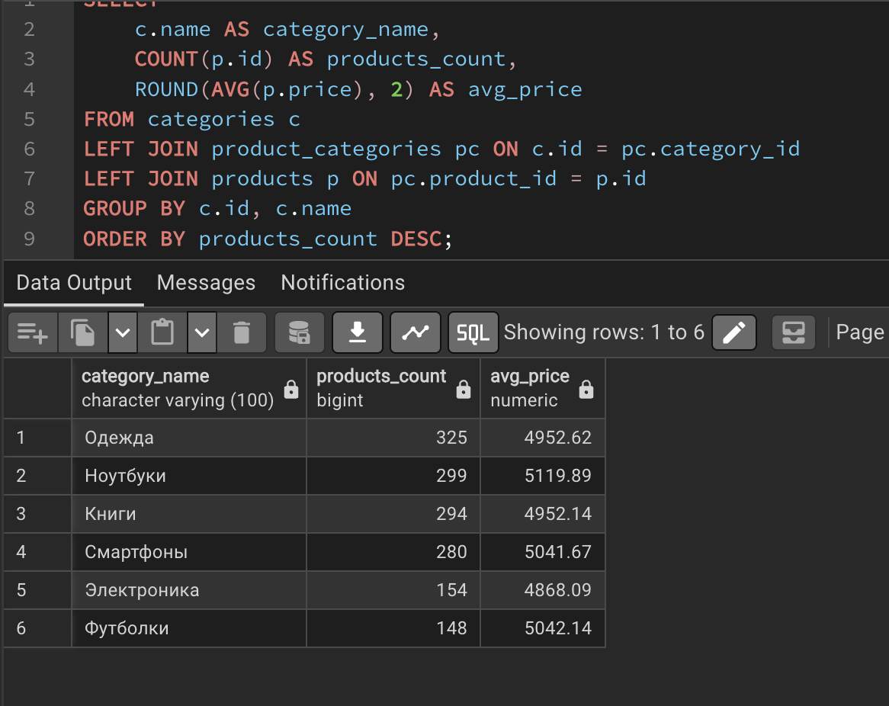
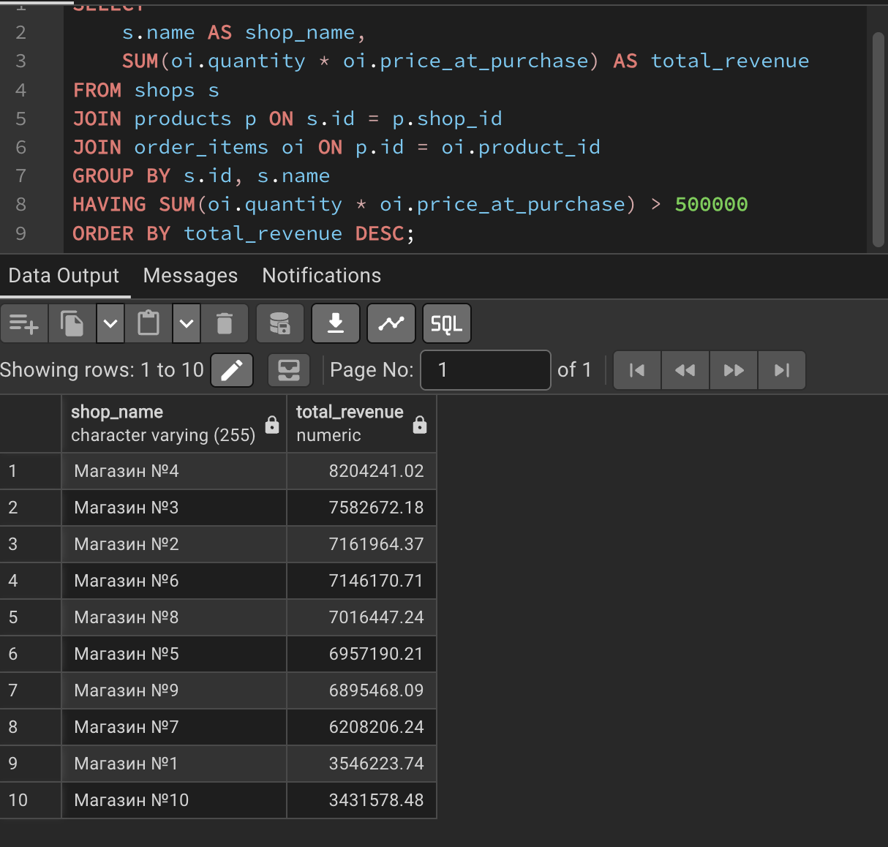
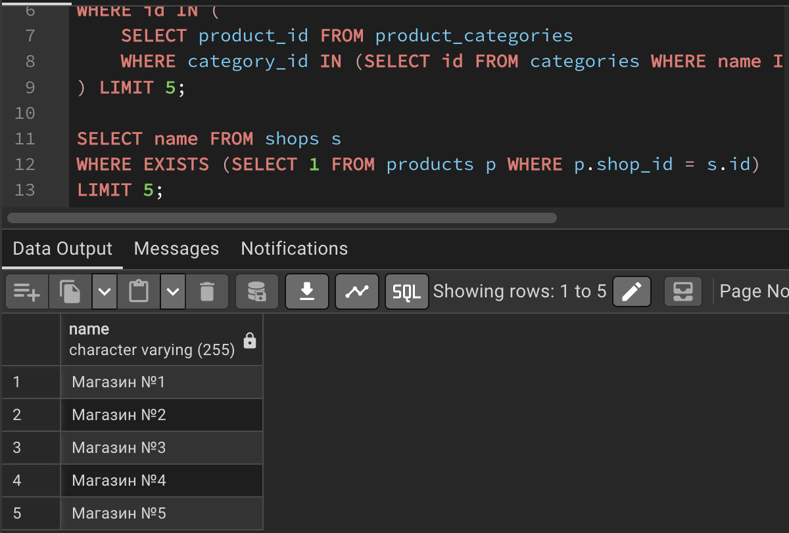
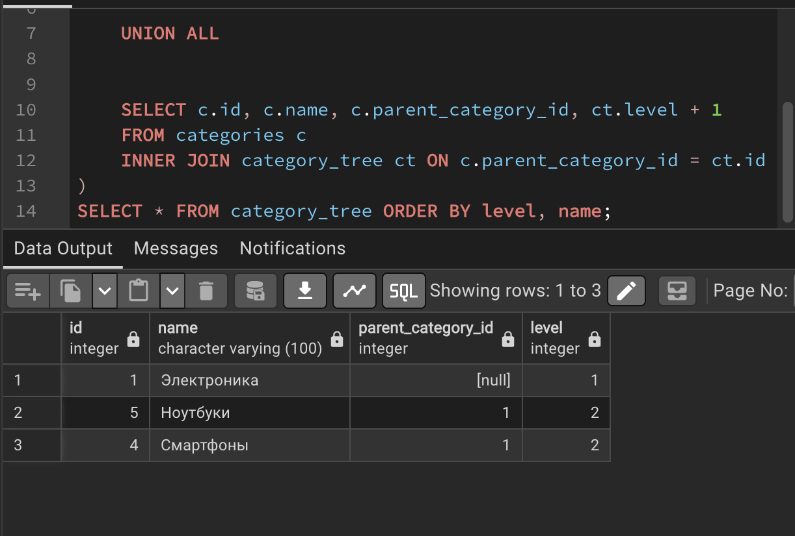
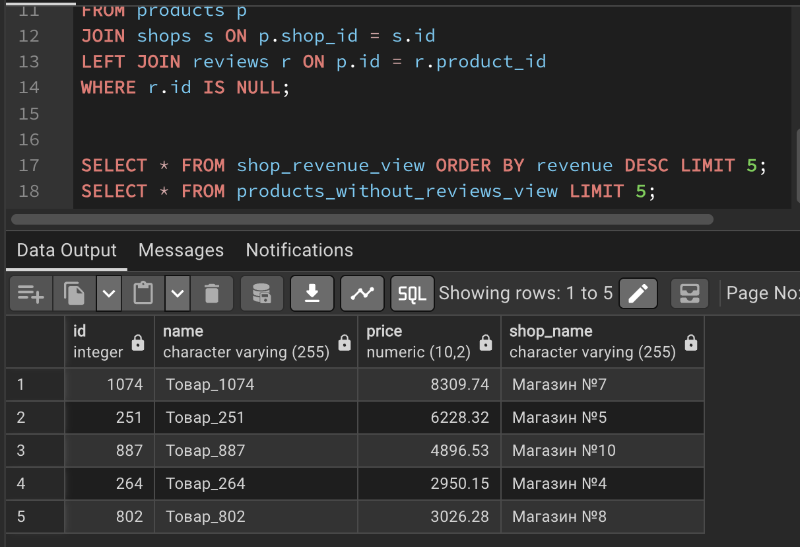

# Отчёт по лабораторной работе №3
## Тема: Многотабличные запросы и аналитические представления

### Выполнила: Овчинникова Анна БВТ2502

---

## 1. Постановка задачи

Составить набор многотабличных и аналитических запросов к спроектированной базе данных маркетплейса и оформить наиболее полезные из них в виде представлений (VIEW). Запросы должны:
- включать внутреннее соединение (INNER JOIN) не менее трёх таблиц;
- демонстрировать левое внешнее соединение (LEFT JOIN) для поиска строк без соответствий;
- использовать агрегатные функции с группировкой (GROUP BY) и фильтрацией групп (HAVING);
- содержать подзапросы разных видов: скалярный, с предикатом IN и с предикатом EXISTS;
- применять общие табличные выражения (CTE), включая рекурсивный CTE для обхода иерархии;
- включать создание и обращение как минимум к двум представлениям (VIEW).

---

## 2. Реализация запросов и результаты

### Задание 1. Внутреннее соединение (INNER JOIN) трёх таблиц
**Текст запроса:**
```sql
SELECT 
    p.name AS product_name, 
    c.name AS category_name, 
    s.name AS shop_name, 
    p.price
FROM products p
INNER JOIN product_categories pc ON p.id = pc.product_id
INNER JOIN categories c ON pc.category_id = c.id
INNER JOIN shops s ON p.shop_id = s.id
ORDER BY p.price DESC
LIMIT 10;
```
**Назначение:** Получить детальный список товаров с указанием их категории и названия магазина-продавца, отсортированный по убыванию цены.
**Результат:**


---

### Задание 2. Левое соединение (LEFT JOIN) для поиска отсутствующих связей
**Текст запроса:**
```sql
SELECT 
    p.id AS product_id, 
    p.name AS product_name, 
    r.id AS review_id
FROM products p
LEFT JOIN reviews r ON p.id = r.product_id
WHERE r.id IS NULL
LIMIT 10;
```
**Назначение:** Найти товары, на которые покупатели ещё не оставили ни одного отзыва. Использование `LEFT JOIN` с условием `IS NULL` — это стандартный и наиболее эффективный способ поиска "сирот" в связанных таблицах.
**Результат:**
\](<Screenshots/lab3_left_join.png>)](<Снимок экрана 2026-10-22 в 20.09.31.png>)

---

### Задание 3. Группировка и агрегация по категориям
**Текст запроса:**
```sql
SELECT 
    c.name AS category_name,
    COUNT(p.id) AS products_count,
    ROUND(AVG(p.price), 2) AS avg_price
FROM categories c
LEFT JOIN product_categories pc ON c.id = pc.category_id
LEFT JOIN products p ON pc.product_id = p.id
GROUP BY c.id, c.name
ORDER BY products_count DESC;
```
**Назначение:** Получить сводную статистику по каждой категории: общее количество товаров и среднюю цену (округлённую до 2 знаков). Используется `LEFT JOIN`, чтобы категории без товаров тоже попали в отчёт с показателем `0`.
**Результат:**


---

### Задание 4. Фильтрация групп с помощью HAVING
**Текст запроса:**
```sql
SELECT 
    s.name AS shop_name,
    SUM(oi.quantity * oi.price_at_purchase) AS total_revenue
FROM shops s
JOIN products p ON s.id = p.shop_id
JOIN order_items oi ON p.id = oi.product_id
GROUP BY s.id, s.name
HAVING SUM(oi.quantity * oi.price_at_purchase) > 500000
ORDER BY total_revenue DESC;
```
**Назначение:** Найти магазины, общая выручка которых превышает 500 000. Условие `HAVING` применяется *после* группировки и агрегации, в отличие от `WHERE`, который фильтрует исходные строки.
**Результат:**


---

### Задание 5. Подзапросы (Скалярный, IN, EXISTS)
**Текст запроса:**
```sql

SELECT name, price FROM products 
WHERE price > (SELECT AVG(price) FROM products) 
LIMIT 5;

SELECT name FROM products 
WHERE id IN (
    SELECT product_id FROM product_categories 
    WHERE category_id IN (SELECT id FROM categories WHERE name IN ('Смартфоны', 'Ноутбуки'))
) LIMIT 5;

SELECT name FROM shops s 
WHERE EXISTS (SELECT 1 FROM products p WHERE p.shop_id = s.id) 
LIMIT 5;
```
**Назначение:** Продемонстрировать три разных подхода к вложенным запросам. `EXISTS` особенно эффективен для проверки существования связей, так как останавливает выполнение подзапроса после нахождения первой совпадающей строки.
**Результат:**


---

### Задание 6. Общие табличные выражения (CTE) и рекурсивный CTE
**Текст запроса:**
```sql

WITH RECURSIVE category_tree AS (

    SELECT id, name, parent_category_id, 1 AS level
    FROM categories
    WHERE name = 'Электроника'
    
    UNION ALL
    

    SELECT c.id, c.name, c.parent_category_id, ct.level + 1
    FROM categories c
    INNER JOIN category_tree ct ON c.parent_category_id = ct.id
)
SELECT * FROM category_tree ORDER BY level, name;
```
**Назначение:** Обойти иерархическую структуру дерева категорий. Рекурсивный CTE позволяет получить все уровни вложенности (например, Электроника -> Смартфоны), что невозможно сделать обычным JOIN с неизвестной глубиной вложенности.
**Результат:**


---

### Задание 7. Создание и использование представлений (VIEW)
**Текст запроса:**
```sql

CREATE OR REPLACE VIEW shop_revenue_view AS
SELECT s.id, s.name, SUM(oi.quantity * oi.price_at_purchase) AS revenue
FROM shops s
JOIN products p ON s.id = p.shop_id
JOIN order_items oi ON p.id = oi.product_id
GROUP BY s.id, s.name;


CREATE OR REPLACE VIEW products_without_reviews_view AS
SELECT p.id, p.name, p.price, s.name AS shop_name
FROM products p
JOIN shops s ON p.shop_id = s.id
LEFT JOIN reviews r ON p.id = r.product_id
WHERE r.id IS NULL;


SELECT * FROM shop_revenue_view ORDER BY revenue DESC LIMIT 5;
SELECT * FROM products_without_reviews_view LIMIT 5;
```
**Назначение:** Инкапсулировать сложную логику запросов в именованные объекты базы данных. Это упрощает код приложения, повышает безопасность (можно дать доступ только к VIEW, а не к таблицам) и гарантирует согласованность бизнес-логики.
**Результат:**


---

## 3. Принятые проектные решения

- **Использование `LEFT JOIN ... WHERE ... IS NULL`** вместо `NOT IN` для поиска товаров без отзывов. Это более надёжный подход, так как `NOT IN` может вернуть пустой результат или вести себя некорректно, если в подзапросе встречаются значения `NULL`.
- **Применение `ROUND(..., 2)`** при вычислении средней цены. Тип `NUMERIC` в PostgreSQL точен, но агрегатные функции могут возвращать много знаков после запятой, что ухудшает читаемость отчётов.
- **Использование CTE (`WITH`)** вместо вложенных подзапросов в `FROM`. Это делает код декларативным, читаемым и лёгким для отладки, так как каждый шаг логически изолирован.
- **Создание `VIEW`** для типовых аналитических выборок. Обычные представления не занимают дополнительного места на диске, но скрывают сложность JOIN-ов от конечного пользователя или фронтенд-приложения.

---

## 4. Ответы на контрольные вопросы

1. **Что такое соединение таблиц и по какому условию оно обычно выполняется?**  
   Соединение (JOIN) объединяет строки двух таблиц в одну результирующую строку. Обычно оно выполняется по условию равенства внешнего ключа одной таблицы и первичного ключа другой (в секции `ON`).
2. **Чем INNER JOIN отличается от LEFT JOIN?**  
   `INNER JOIN` возвращает только те строки, для которых есть совпадение в обеих таблицах. `LEFT JOIN` возвращает все строки из левой таблицы, подставляя `NULL` для столбцов правой таблицы, если совпадения нет. Пример: список всех товаров, включая те, у которых пока нет ни одной продажи.
3. **Какие агрегатные функции вы знаете? В чём различие между COUNT(*) и COUNT(столбец)?**  
   Функции: `COUNT`, `SUM`, `AVG`, `MIN`, `MAX`. `COUNT(*)` считает абсолютно все строки группы, а `COUNT(столбец)` считает только те строки, где значение в этом столбце не равно `NULL`.
4. **Для чего предназначена секция GROUP BY и что допустимо в списке выборки при группировке?**  
   `GROUP BY` делит строки на группы по значениям указанных столбцов. В `SELECT` при группировке допустимы только столбцы, перечисленные в `GROUP BY`, и агрегатные функции, применённые к остальным столбцам.
5. **В чём различие между WHERE и HAVING и в каком порядке они выполняются?**  
   `WHERE` фильтрует исходные строки *до* этапа группировки. `HAVING` фильтрует уже сгруппированные данные по результату агрегатных функций. Логический порядок: `WHERE` → `GROUP BY` → `HAVING`.
6. **Что такое подзапрос? Чем коррелированный подзапрос отличается от некоррелированного?**  
   Подзапрос — это запрос, вложенный в другой. Некоррелированный выполняется один раз независимо от внешнего запроса. Коррелированный ссылается на столбцы внешнего запроса и логически выполняется заново для каждой его строки.
7. **Как работает предикат EXISTS и когда его удобно применять?**  
   `EXISTS` возвращает `TRUE`, если подзапрос вернул хотя бы одну строку. Он удобен и эффективен для проверки существования связанных данных (например, "есть ли у магазина товары"), так как СУБД останавливает поиск после нахождения первого совпадения.
8. **Что такое общее табличное выражение (CTE) и для чего нужен рекурсивный CTE?**  
   CTE (конструкция `WITH`) именует промежуточный результат запроса, делая сложный SQL читаемым. Рекурсивный CTE (`WITH RECURSIVE`) ссылается сам на себя и используется для обхода иерархических структур (деревьев), например, для получения всех подкатегорий.
9. **Что такое представление (VIEW)? Хранит ли обычное представление данные?**  
   `VIEW` — это сохранённый в базе данных именованный запрос. Обычное представление **не хранит** данные физически; при каждом обращении к нему СУБД выполняет лежащий в его основе `SELECT` и возвращает актуальные данные из базовых таблиц.
10. **Чем материализованное представление отличается от обычного?**  
    Материализованное представление (`MATERIALIZED VIEW`) физически сохраняет результат запроса на диске. Оно работает намного быстрее при чтении, но данные в нём устаревают и требуют ручного обновления командой `REFRESH MATERIALIZED VIEW`.

